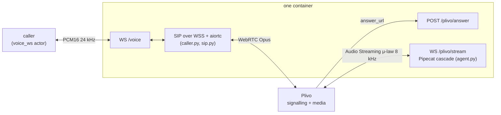

# rory-plivo

Rory, a customer-service voice agent for Acme Energy, answering a **real Plivo
call**. Plivo is a voice-AI telephony platform: it carries the call and streams
its audio to your own agent over
[Audio Streaming](https://www.plivo.com/docs/voice-agents/audio-streaming/overview).
Plivo's reference stack for that is Pipecat, so the agent here is the same
cascade as [`pipecat/`](../pipecat/) — Deepgram STT, gpt-4.1-mini, ElevenLabs
TTS — and what this implementation measures is what Plivo adds: its media path,
8 kHz μ-law telephone audio, and its latency.

Only the transport lives here. The tools, the vendor clients, the verification
gate and the system prompt are shared with the other implementations and live
at the repo root — see the layout section in the [root README](../README.md).

## How a call flows

No phone number is involved. The caller joins as a **Plivo endpoint** over
WebRTC, the way Plivo's browser SDK does, and the endpoint's own Application
routes the call back into the same pod:



At boot, before `/health` answers:

1. `rory_tools/tunnel.py` gets a public HTTPS URL for `:8008` (`PUBLIC_BASE_URL`,
   or a `cloudflared` quick tunnel).
2. `plivo_api.py` creates an Application whose answer_url is
   `<public>/plivo/answer`, and an Endpoint bound to it. Both belong to this pod
   alone, so parallel pods never share routing; both are deleted at shutdown.

Each `/voice` connection then registers the endpoint at
`wss://client.plivo.com/signalling`, INVITEs over WebRTC with aiortc, and
bridges audio both ways. Plivo answers by fetching `/plivo/answer`, which
returns a bidirectional `<Stream>` to `/plivo/stream`; Rory greets on that
stream connecting. Barge-in clears Plivo's queued audio (`clearAudio`), and a
pipeline end hangs the call up through Plivo's REST API.

Tool calls never cross Plivo: the pipeline runs in this process and calls the
shared dispatcher directly, as in `pipecat/`.

## Interop notes

Found against Plivo's live service; each is commented where it is fixed:

- **DTLS session tickets off** (`caller.py`). With a ticket, aiortc's final
  handshake flight is a single 1500-byte datagram that does not survive the
  path. Plivo then never completes DTLS and sends no media, while aiortc reports
  `connected`.
- **Plivo's SDP answer** has no `a=mid`, `a=group:BUNDLE` or direction line;
  they are added back before aiortc reads it.
- **ACK routing** (`sip.py`): the 200 OK's ACK goes to its Contact, through the
  Record-Route set.

## Configuration

| Variable | Purpose |
| --- | --- |
| `PLIVO_AUTH_ID`, `PLIVO_AUTH_TOKEN` | Plivo account; creates the per-pod Application and Endpoint, and hangs calls up |
| `OPENAI_API_KEY`, `DEEPGRAM_API_KEY`, `ELEVENLABS_API_KEY` | The cascade |
| `STRIPE_API_KEY`, `STRIPE_API_BASE`, `FINERACT_API_BASE` | Rory's tools (injected by the bench) |
| `PUBLIC_BASE_URL` | Optional public HTTPS URL for `:8008`; otherwise a quick tunnel is opened |
| `LLM_MODEL`, `DEEPGRAM_MODEL`, `ELEVENLABS_VOICE_ID`, `ELEVENLABS_TTS_MODEL` | Same defaults as `pipecat/` |

## Build

```bash
docker build --platform linux/amd64 -f plivo/Dockerfile -t rory-plivo .
```
