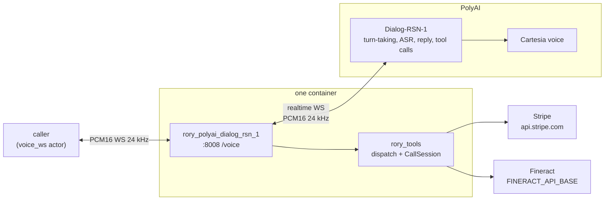

# rory-polyai-dialog-rsn-1

Rory, a customer-service voice agent for Acme Energy, on PolyAI's
**Dialog-RSN-1** realtime API. Dialog-RSN-1 is an audio-native dialog model:
it hears the caller's raw audio, decides when their turn is over, and writes
either a reply or one tool call in the same generation. The service voices
each reply itself with a Cartesia voice and sends the audio at the pace it
plays. Rory explains bills, takes payments, and sets up payment arrangements
end to end, calling **two real vendor APIs**: Stripe for billing and Apache
Fineract for payment arrangements.

This is a separate candidate from [`polyai/`](../polyai/). That one pushes Rory
onto an Agent Studio project at boot and runs whatever model the project is
set to in Studio. This one opens Dialog-RSN-1 directly, one session per call,
with its own prompt and the shared tools sent in `session.update`.

The transport and its prompt live here. The tools, the vendor clients and the
verification gate are shared with the other implementations and live at the
repo root. See the layout section in the [root README](../README.md).

## What it does

One process runs inside the container: uvicorn serving
`rory_polyai_dialog_rsn_1/web.py`, which exposes `WS /voice` and `/health` on
`:8008`.

Each `/voice` connection opens its own websocket to
`wss://api.studio.poly.ai/v1/realtime`, which speaks the OpenAI Realtime wire
format (GA schema):

1. Wait for `session.created`, send `session.update` with this candidate's
   prompt plus the frozen-clock date context, the 16 shared tools, 24 kHz PCM16 input,
   server turn detection and the voice, then wait for `session.updated`. A
   refused update applies none of its fields, so anything else ends the call.
2. Send a `response.create` whose one-off instructions ask for the shared
   greeting, so Rory speaks first.
3. Forward the caller's PCM16 frames as `input_audio_buffer.append`, and the
   reply's `response.output_audio.delta` bytes straight back. Both legs are
   24 kHz, so nothing is resampled.
4. Run each `response.function_call_arguments.done` through
   `rory_tools.dispatch` as soon as it arrives, on a worker thread and one at
   a time, while the call's spoken `utterance` plays (PolyAI's
   [OpenAI migration guide](https://docs.poly.ai/dialog-rsn-1/coding-agents/openai-realtime-migration.md):
   "The tool starts at once."). Answer with a
   `function_call_output`. Once the response ends `completed` and its calls
   have answered, send `response.create`, since a tool result never starts a
   turn on its own. A response the caller cancelled by barging in gets no
   `response.create`, because the barge-in starts its own.



## What PolyAI owns

- **Turn-taking.** A voice-activity detector proposes each turn end and the
  model confirms it from the conversation. `create_response` is the only
  `turn_detection` field the service reads; silence duration and thresholds
  are ignored, so the benchmark's ~0.8 s end-of-turn standard is not pinned
  here.
- **Barge-in.** A confirmed interruption cancels the reply
  (`response.done` with status `cancelled`). The server paces its own audio,
  so it knows what the caller heard and trims history itself; the bridge sends
  no `conversation.item.truncate`.
- **Speech.** `output_modalities: ["audio"]`, a Cartesia voice id in
  `audio.output.voice`.

## Its own prompt

This is the one candidate that doesn't load the shared prompt. Dialog-RSN-1
treats any text it writes as the end of its turn (PolyAI's prompt guide: "One
output per turn"), so a line like "tell the caller, then transfer" hands the
floor back before the transfer runs, which cuts tool chains short.
[`agent_desc.txt`](rory_polyai_dialog_rsn_1/agent_desc.txt) is a copy of
[`rory_tools/agent_desc.txt`](../rory_tools/agent_desc.txt) with six lines
changed: one new rule (put the words in the tool's `utterance`, and don't say
them again once it returns), `verify_caller` called with a holding line, and
four "tell the caller, then transfer" lines rewritten as "call
`transfer_to_human` with `utterance` set to…". See them with:

```bash
diff rory_tools/agent_desc.txt polyai-dialog-rsn-1/rory_polyai_dialog_rsn_1/agent_desc.txt
```

The greeting is still the shared one. A change to the shared prompt has to be
copied here by hand.

## Speaking while a tool runs

Dialog-RSN-1 outputs either text or one tool call, never both, and a turn
runs tool, tool, ..., text. Without help, **the caller hears nothing while a
chain of tools runs**. PolyAI's fix is its `poly_spoken` extension: a required
string argument the model fills as part of the call, which the server speaks
at once. Two tools get one, named `utterance`
([`tools.py`](rory_polyai_dialog_rsn_1/tools.py)):

- `verify_caller`, the first lookup of every call ("One moment while I check
  those details.").
- `transfer_to_human`, so the caller hears why they're being put through.

This is the one place the tool surface departs from the shared declaration.
The parity run checks that only these two tools carry `utterance`, that it is
a required `poly_spoken` string, and that everything else matches exactly.
The shared implementations read only their own arguments, so `utterance`
reaches `dispatch` unread. Other tools stay silent until the reply, as
PolyAI's guide advises for fast tools.

`transfer_to_human` still answers "Tell the caller they are being
transferred, then stop.", so after the hold line Rory usually confirms the
transfer once more in its closing reply.

## Configuration

| Variable | Required | Default | Notes |
| --- | --- | --- | --- |
| `POLY_API_KEY` | yes | | A workspace API key from the **API Keys** tab in Agent Studio. A personal access token is refused. |
| `POLYAI_RSN_URL` | no | `wss://api.studio.poly.ai/v1/realtime` | A key works only on the host matching the Studio that issued it. Enterprise keys from `studio.us.poly.ai` need `wss://api.us.poly.ai/v1/realtime`. |
| `POLYAI_RSN_VOICE` | no | `db6b0ed5-…` | A Cartesia voice id. The default is the voice the [`cartesia`](../cartesia/) candidate speaks with. An id Cartesia doesn't know fails every reply with `audio_synthesis_failed`. |
| `STRIPE_API_KEY` | yes | | Shared with every transport; the bench injects a sandbox fixture. |

The bench also injects `STRIPE_API_BASE` and `FINERACT_API_BASE`, which the
shared vendor clients honor.

## Running it

```
docker build --platform linux/amd64 -f polyai-dialog-rsn-1/Dockerfile -t rory-polyai-dialog-rsn-1 .
```

The image serves `/voice` and `/health` on `:8008` and is ready as soon as
uvicorn is up; nothing is provisioned at boot.

## Running the tests

```bash
uv run pytest polyai-dialog-rsn-1/tests
```

The parity run checks the tools sent in `session.update` against the shared
declaration, allowing only the `utterance` argument described above. The
lifecycle tests run a whole call against a local websocket
standing in for PolyAI (handshake, greeting, audio both ways, one tool
round run while its hold line plays), plus the refused-session path,
tool calls in cancelled responses, failure events
and the close codes. The model and the voice need a live session and a key.

## Known limits

- **Concurrency.** PolyAI caps open sessions per account: **2** on the
  sign-up credit, **10** once a card is on file. The next handshake past the
  cap is refused with `429`, which surfaces as a failed call, so keep bench
  parallelism at or below the account's cap.
- **One response at a time.** If the caller's turn opens a response while a
  tool round is still running, the bridge's follow-up `response.create` is
  refused with `conversation_already_has_active_response`. PolyAI's
  [error table](https://docs.poly.ai/api-reference/dialog-rsn-1/reference.md#errors)
  makes that retryable after `response.done`, so the bridge sends it again
  when the open response ends. If that response already answered the
  results, the caller hears two replies in a row.
- **English only**, for now.
- **Session length.** 60 minutes per session and a 5-minute idle timeout,
  both far beyond a bench call.
